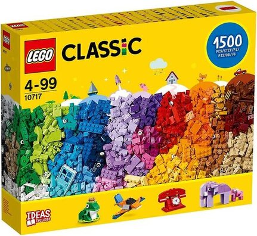
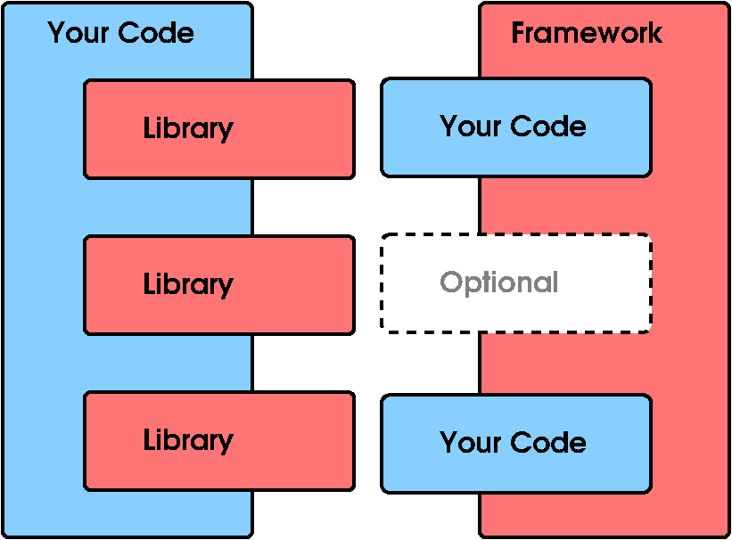

CS415 - Wednesday, November 04 - Lecture 4 - Module 2

# Topics:
* [Opening Exercises](#opening-exercises)
* [Check-In and Q&A](#check-in-and-qa)
* [Submitting Today's Exit Ticket](#submitting-todays-exit-ticket)
* [The Django Web Application Framework](#the-django-web-application-framework)
* [Django Setup and Connecting to the Database](#django-setup-and-connecting-to-the-database)
* [How a Request Flows Through Django REST Framework](#how-a-request-flows-through-django-rest-framework)
* [Your First GET Endpoint: users](#your-first-get-endpoint-users)
* [Break](#break)
* [Work Time](#work-time)
* [Wrap Up & Parting Thoughts](#wrap-up--parting-thoughts)


------------------------------------------------------------
# Opening Exercises

### Song *Hymn: #19 [We Thank Thee, O God, for a Prophet](https://www.churchofjesuschrist.org/media/music/songs/we-thank-thee-o-god-for-a-prophet)*

### Prayer

### Today's Spiritual Thought

Since we last met, what is one small step you took that worked? The Lord teaches line upon line, and this course is built the same way: each week adds to the last. Today the line is one API endpoint, and by the end of the week you will have seven.


### Scripture

> For he will give unto the faithful line upon line, precept upon precept; and I will try you and prove you herewith.
>
> -- [Doctrine and Covenants 98:12](https://www.churchofjesuschrist.org/study/scriptures/dc-testament/dc/98?lang=eng&id=p12#p12)


### Discussion Questions

0.  Where did you feel stuck this week, and what helped you get unstuck?
0.  How can you help a classmate take one small step in our time together today?


# Check-In and Q&A

Today's work depends on your database from the last meeting. Let's make sure it is there before we build on it.

## Is your database ready?

Check these four things on your own computer:

0.  Docker Desktop shows your database container with status Running and port `5432:5432`
0.  `docker exec -it container_cs415_db bash` opens a shell in the container
0.  `psql -U postgres` and then `\c cs415` connect you to your database
0.  `\dt` lists 7 tables, and `select * from webuser;` shows rows

If any of these fail, tell me now. If yours works, you may be paired with someone whose does not.


## Is Python ready?

Type `python --version` in a terminal (or `python3 --version`). You should be on version 3.14. Is your `cs415_api` repository cloned and open in VS Code?

For help with your database, see the [PostgreSQL Database](https://ensign.instructure.com/courses/27288/pages/postgresql-database) and [Accessing the Data](https://ensign.instructure.com/courses/27288/pages/accessing-the-data) pages. If Docker shows an error, read its logs first.

*Check:* What command shows how many tables your database has?


# Submitting Today's Exit Ticket

Part of your grade in this class depends upon your attendance. You will help me record your attendance by following these steps:

0.  Find the announcement in our Canvas course titled Module2/Lec04-Wed_Nov_04
1.  Read it and pick one of the questions to respond to
2.  Post a response to the announcement

## Exit Ticket Questions

Pick **one** to answer in your Canvas reply:

0.  Name the four files you change to add a GET endpoint, in the order you change them, and say what each one does.
0.  What does your `users/` endpoint return so far? Does it include the password field, and why or why not?
0.  What is one thing about Django or the API that you are still unsure about?


# The Django Web Application Framework

[https://www.djangoproject.com/](https://www.djangoproject.com/)

Django is a **web application framework** written in the Python programming language.

**IMPORTANT! when you search for Django resources online make sure they match the version of Django you have installed!**

The version of Django that we'll be using in this class is v6.1.x (the 3rd
component of the version number is not significant).   My plan is to stick with
version 6.1.x throughout the block, even if a newer minor version is released.

Official Documentation for our version of Django: [https://docs.djangoproject.com/en/6.1/](https://docs.djangoproject.com/en/6.1/)

## What is a Web Application Framework?

A web application framework is software that provides a fundamental structure to
support the rapid development of web applications.


### Libraries vs. Frameworks

Software developers rely on pre-written collections of code to make their lives
easier.  We can separate these collections into two broad categories: libraries
and frameworks.


#### Library

A collection of classes, functions and variables which don't need to be used in
a particular way.  You have freedom to mix and match code from a library as you
see fit.

A library is a box of generic Legos(tm) which you can assemble in any way you wish.




#### Framework

A collection of classes, functions and variables which imposes a particular
structure on your project.  A framework not only dictates which
files/classes/methods are to be used, but also where and when.  A framework
will suggest a "shape" for your project.

A framework is a specific Lego(tm) set meant to build a particular toy.

")


A web application framework:

-   Helps us build webapps quickly
-   Holds the rest of the application together
-   Provides and defines the shape of the application


Frameworks make use of the software architecture concept of "Inversion of control".  Put another way:

> The key difference between a library and a framework is "Inversion of
> Control".  When you call a method from a library, you are in control.
> But with a framework, the control is inverted: the framework calls you.
>
> -- https://www.programcreek.com/2011/09/what-is-the-difference-between-a-java-library-and-a-framework/





### Django is a framework, not a library

The creators of Django made choices in its design that impact your experience as a developer. Some of their choices will affect what options are open to you. Like all things in engineering, these choices are careful tradeoffs between competing interests.

#### Django Pros

-   Django gives you a quicker route to your working app
-   It guides you as you make your app, choices are already made for you
-   Batteries are included


#### Django Cons

-   You give up a lot of control over how your project is organized
-   If your app isn't in Django's "shape", then Django gets in your way more than it helps
-   Sometimes what you want is a solar panel, not a battery


## What does Django actually do?

While you are in the process of developing your application Django provides you
with a basic web server and a simple database engine.  Once your application is
complete you would deploy your Django application into a "real" web server such
as Apache (httpd) or Nginx.

What do "real" web servers actually do?

### Static servers

In the early days of the internet, web servers responded to HTTP requests by
sending back HTTP headers followed by the contents of a file copied straight
from the hard disk.  Each identical request resulted in an identical response.
Static web servers mapped URLs to local files.  Except for small details like the
`Date` HTTP header, the content of each response will always be the same.

    $ nc unnovative.net 80
    GET /index.html HTTP/1.0

    $ nc google.com 80
    GET /teapot HTTP/1.1

*A webpage served by a Static server is just a __file__*


### Dynamic servers

Some web servers respond to HTTP requests by calling a *function* which can
return different content each time.

The webpage at http://checkip.dyndns.com returns a different HTML document
depending upon the IP address you visit from (not unlike the `/debug` page from
Assignment #1).

    $ nc checkip.dyndns.com 80
    GET / HTTP/1.1
    Host: checkip.dyndns.com
    Connection: close

This function's input is the entirety of the HTTP request, including the method
of the request (`GET`, `PUT`, `POST`, `DELETE`), the URL requested, all of the
HTTP headers as well as any data sent by the user agent.

This response can be *anything* that a function can compute from these inputs.
The function could return:

*   The contents of an HTML file found on the hard drive
*   A hard-coded string that contains an HTML document
*   A dynamically generated string which combines data from the HTTP
    request headers and `GET` request parameters
*   An HTML document generated by examining data `POST`ed from an HTML form
*   Information from weather sensors connected to the web server...
*   Pictures of lava lamps


*You can think of a webpage served by a Dynamic server as a __function__ that takes an HTTP request as input and returns an HTTP response*

Commonly, this *function* will utilize a *database* as part of its computation.


# Django Setup and Connecting to the Database

Follow the [Django - Setup and Run](https://ensign.instructure.com/courses/27288/pages/django-setup-and-run) page in order. Django runs on Python, inside a **virtual environment**, a private folder of packages for one project.


## Demo and your turn

Work in the `cs415_api` project in VS Code. Your database container must be running.

0.  Check Python: `python --version` (or `python3 --version`)
0.  Create the virtual environment: `python -m venv env`
0.  Activate it.
    -   Windows: `env\Scripts\activate`
    -   Mac: `source env/bin/activate`
    -   **You should see `(env)` at the start of your prompt!**
0.  Install the packages listed on the page with `pip install`, one at a time. If any fails, ask for help
0.  Save the list with `pip freeze > requirements.txt`
0.  Create the project: `django-admin startproject cs415`
0.  Move into the project folder: `cd cs415`
0.  Edit `cs415/settings.py` as shown on the page: allowed hosts, CORS settings, installed apps, middleware, and the `DATABASES` section that points at your container
0.  Start the server: `python manage.py runserver`, then open `http://127.0.0.1:8000/` and look for the Django welcome page
0.  Press Ctrl+C to stop the server
0.  Have Django read your tables: `python manage.py inspectdb > ./cs415/models.py`
0.  Open `models.py` and check that it has a class for each of your tables

Always have `(env)` in your prompt when you work on this project. Run `manage.py` commands from the folder that contains `manage.py`.

*Check:* How do you know your virtual environment is active?


# How a Request Flows Through Django REST Framework

**Django REST Framework** (DRF) is the toolkit you will use to build your API. Before you write code, learn the path a request travels. Study these three pages from the Preparation & Resources:

0.  [DRF Architecture data flow](https://ensign.instructure.com/courses/27288/files/10274211)
0.  [DRF Sequence data flow](https://ensign.instructure.com/courses/27288/files/10243787)
0.  [API Creation Flow](https://ensign.instructure.com/courses/27288/files/10244038)


### What are all of the files Django makes for me?

It is common for code frameworks to provide you with a bunch of *boilerplate* code.  Part of learning a framework is learning how to navigate and work within its structure.

#### Boilerplate code

> In computer programming, boilerplate code, or simply boilerplate, are sections of code that are repeated in multiple places with little to no variation. When using languages that are considered verbose, the programmer must write a lot of boilerplate code to accomplish only minor functionality.
>
> [Wikipedia: Boilerplate code](https://en.wikipedia.org/wiki/Boilerplate_code)


The `django-admin startproject cs415` command creates these boilerplate files. Some of which you will edit and modify, and other that you may politely ignore:

```tree --charset=ascii
cs415                   Project directory; its name doesn't really matter
|-- cs415               Project package; Django looks for settings in here.  The name of this directory matters!
|   |-- __init__.py     Makes this directory importable as a Python module
|   |-- asgi.py         Pertains to the ASGI interface to a "real" web server
|   |-- models.py       Python classes that correspond to tables in the PostgreSQL database
|   |-- serializers.py  Defines how database records are translated to JSON
|   |-- settings.py     Our project's settings
|   |-- urls.py         The "receptionist" who connects HTTP requests to Python code
|   |-- views.py        Contains the code that runs in response to a request
|   `-- wsgi.py         Pertains to the WSGI interface to a "real" web server
|-- __pycache__         Python files pre-compiled for speed; its contents can be deleted at any time
`-- manage.py           Basically the same thing as django-admin, but customized to your project
```


## One HTTP request involves four files

When a browser asks for `/users/`, its request passes through four files in your project:

0.  `urls.py` the "receptionist" of our app; it matches the URL pattern and picks the view function that will be called to serve it
0.  `views.py` holds the view class that decides how to respond to GET, POST, and other request types
0.  `serializers.py` holds the **serializer**, which decides which fields to show and turns rows into JSON
0.  `models.py` defines **model**, which is the Django version of one database table

The PostgreSQL database sits behind the model. The answer travels back the same way, ending as an HTTP response with JSON.


## How to add an API endpoint

Work backward from the data:

0.  Model: make sure it matches the table
0.  Serializer: create a serializer that uses the model
0.  View: create a view that uses the serializer
0.  URL: add a URL pattern that points to the view

*Check:* Which file decides that the password column is never shown?


# Your First GET Endpoint: users/

You will build one **GET endpoint** for the `WebUser` table, then repeat the pattern for the rest. Follow [DRF Model, Serializer, View - Creating a GET Endpoint](https://ensign.instructure.com/courses/27288/pages/django-rest-framework-drf-model-serializer-view-creating-a-get-endpoint) and [DRF URLS - Accessing the Endpoints](https://ensign.instructure.com/courses/27288/pages/drf-urls-accessing-the-endpoints).

## Demo and your turn

Work in the folder that contains `manage.py`, with `(env)` in your prompt.

0.  Model: your `models.py` from `inspectdb` already has the table
0.  Serializer: create `serializers.py` with a serializer for the model. Choose the fields to return. **Do not** return the `password` field!
0.  View: create `views.py` with a view class that has a `get` function returning all the rows
0.  URL: in `urls.py`, import your view and add the URL pattern `users/`
0.  Start the server with `python manage.py runserver`
0.  Open `http://127.0.0.1:8000/users/` in your browser. You should see the data from your database as JSON

You can also test with **Postman**, a free tool for sending requests to an API. Choose GET, paste the URL, and click Send.

## Repeat for every table

Each table gets its own serializer, view, and URL. Use these URL names:

*   `users/`
*   `address-types/`
*   `addresses/`
*   `phone-types/`
*   `phones/`
*   `user-infos/`
*   `pages/`

*Check:* Which of the four files do you change to add a new endpoint, and in what order?


# Break

Take 10 minutes.


# Work Time

Use the rest of class on your assignments while I help:

0.  Finish your [Pulling API Data](https://ensign.instructure.com/courses/27288/assignments/1629928) endpoints and screenshots
0.  Finish your [Ponder and Respond #2 - Connecting Principles](https://ensign.instructure.com/courses/27288/assignments/1629922)


Push your work to GitHub as you go. If you finish early, help a classmate who is stuck.


# Wrap Up & Parting Thoughts

## Due this week

0.  [Pulling API Data](https://ensign.instructure.com/courses/27288/modules/items/3250468): upload seven screenshots, one for each of `users/`, `address-types/`, `addresses/`, `phone-types/`, `phones/`, `user-infos/`, and `pages/`. Each must show the URL and all of the JSON
0.  [Ponder and Respond #2 - Connecting Principles](https://ensign.instructure.com/courses/27288/assignments/1629922): read the assigned talk and scripture, then answer all four reflection questions thoughtfully

The Ponder and Respond assignments together are about a quarter of your course grade. Watch Canvas for updates and due dates.

## Keep your work

Push your `cs415_db` and `cs415_api` repositories to GitHub. Next week builds directly on both.

## What is next

Next meeting you will add documentation to your API with Swagger, and build a filtered GET endpoint plus POST and PATCH endpoints.


